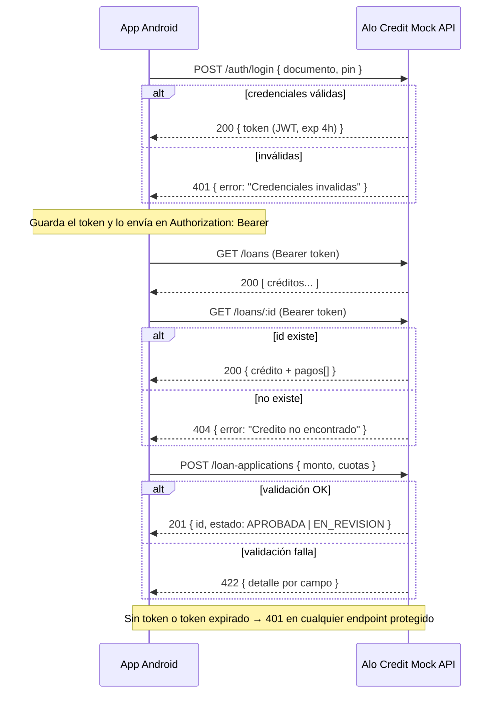
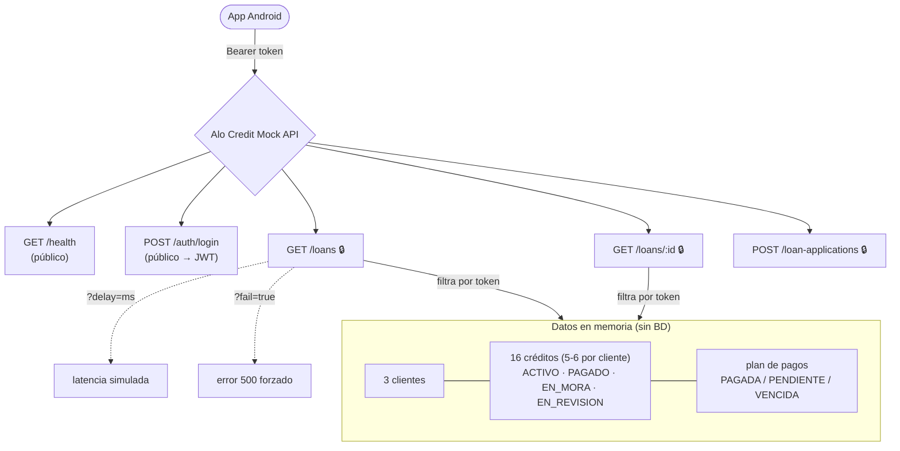

# Alo Credit — Mock Backend

[](https://github.com/Alo-Credit/prueba-tenica-backend-mobile/actions/workflows/ci.yml)

API simulada de una fintech de créditos (**Alo Credit**), construida en Node.js + Express, pensada como backend de apoyo para la **prueba técnica de un desarrollador mobile Android**.

- Sin base de datos: todos los datos viven **en memoria**.
- Autenticación con **JWT** (expira en **4 horas**).
- **CORS abierto** y **log de cada petición** en consola.
- Utilidades para probar el manejo de errores del candidato: latencia simulada (`?delay`) y error forzado (`?fail`).

> 📋 **¿Eres el/la candidato/a?** Lee el enunciado de la prueba en **[PRUEBA_TECNICA.md](PRUEBA_TECNICA.md)**.

---

## Requisitos

- **Node.js** 18+ (probado en Node 20), o
- **Docker** / **Docker Compose** (opción recomendada, ya viene dockerizado).

---

## Cómo correrlo

### Opción A — Local con npm

```bash
npm install
npm start
```

El servidor queda escuchando en **http://localhost:3000**.

### Opción B — Docker

```bash
docker build -t alo-credit-mock .
docker run -p 3000:3000 alo-credit-mock
```

### Opción C — Docker Compose (recomendada)

```bash
docker compose up --build
```

Para detenerlo:

```bash
docker compose down
```

---

## Clientes demo

Hay **3 clientes** en memoria. Cada token solo puede ver **sus propios** créditos (ver nota de _scoping_ en `GET /loans`).

| documento     | pin    | nombre          | créditos |
|---------------|--------|-----------------|----------|
| `123456789`   | `1234` | Cliente Demo    | 6        |
| `987654321`   | `2468` | Maria Gomez     | 5        |
| `1122334455`  | `1357` | Carlos Ramirez  | 5        |

> El principal para la prueba es **`123456789` / `1234`**; los otros dos sirven para verificar que la app usa el token correcto y que cada cliente solo ve lo suyo.

---

## Diagramas

### Flujo de autenticación y consumo (secuencia)



### Mapa de endpoints



## Endpoints

### 0. `GET /health`

Endpoint público (sin token) para verificar que el servidor está arriba.

**200 OK**
```json
{ "status": "ok", "service": "alo-credit-mock", "uptime": 12.34 }
```

### 1. `POST /auth/login`

Autentica al cliente demo y devuelve un JWT (válido 4 horas).

**Request**
```json
{ "documento": "123456789", "pin": "1234" }
```

**200 OK**
```json
{ "token": "<JWT>" }
```

**401 Unauthorized** (credenciales incorrectas)
```json
{ "error": "Credenciales invalidas" }
```

---

### 2. `GET /loans`

Lista los créditos **del cliente autenticado** (según el `documento` del token). **Requiere** header `Authorization: Bearer <token>`.

> 🔐 **Scoping:** cada cliente solo recibe sus propios créditos. Con otro token verás otra lista distinta.

**Query params opcionales**
- `?delay=2000` → simula 2 s de latencia.
- `?fail=true` → fuerza un `500` para probar el manejo de errores.

**200 OK**
```json
[
  { "id": "1", "monto": 1500000, "cuotas": 12, "estado": "ACTIVO", "fecha": "2025-01-15", "saldoPendiente": 875000 },
  { "id": "2", "monto": 800000,  "cuotas": 6,  "estado": "PAGADO",  "fecha": "2024-06-10", "saldoPendiente": 0 }
]
```

---

### 3. `GET /loans/:id`

Detalle de un crédito, incluyendo su **plan de pagos** (`pagos[]`). Requiere token.

**200 OK**
```json
{
  "id": "1",
  "monto": 1500000,
  "cuotas": 12,
  "estado": "ACTIVO",
  "fecha": "2025-01-15",
  "saldoPendiente": 875000,
  "pagos": [
    { "numeroCuota": 1, "fechaVencimiento": "2025-02-15", "valor": 125000, "estado": "PAGADA" },
    { "numeroCuota": 6, "fechaVencimiento": "2025-07-15", "valor": 125000, "estado": "PENDIENTE" }
  ]
}
```

**404 Not Found** (id inexistente **o crédito de otro cliente**)
```json
{ "error": "Credito no encontrado" }
```
> Por seguridad, pedir un crédito que pertenece a otro cliente también responde `404` (no se revela que existe).

---

### 4. `POST /loan-applications`

Crea una solicitud de crédito. Requiere token.

**Request**
```json
{ "monto": 1500000, "cuotas": 12 }
```

**Validaciones**
- `monto`: entre **100.000** y **5.000.000** COP.
- `cuotas`: entero entre **1** y **24**.

**201 Created**
```json
{ "id": "1001", "estado": "APROBADA" }
```
> `estado` = `APROBADA` si `monto ≤ 2.000.000`, si no `EN_REVISION`.

**422 Unprocessable Entity** (falla validación, detalle por campo)
```json
{
  "error": "Error de validacion",
  "detalle": {
    "monto": "El monto debe estar entre 100.000 y 5.000.000 COP",
    "cuotas": "Las cuotas deben estar entre 1 y 24"
  }
}
```

---

## Comportamiento de autenticación

Cualquier petición a endpoints protegidos **sin token** o con **token expirado/ inválido** responde:

**401 Unauthorized**
```json
{ "error": "Token invalido o expirado" }
```

---

## Datos semilla

**3 clientes** con **16 créditos** en total (5-6 cada uno), en distintos estados. Cada crédito pertenece a un cliente y solo es visible con su token.

**Cliente Demo — `123456789` (6 créditos)**

| id | monto      | cuotas | estado       | saldoPendiente |
|----|------------|--------|--------------|----------------|
| 1  | 1.500.000  | 12     | ACTIVO       | 875.000        |
| 2  | 800.000    | 6      | PAGADO       | 0              |
| 3  | 3.000.000  | 24     | EN_MORA      | 2.250.000      |
| 4  | 500.000    | 3      | EN_REVISION  | 500.000        |
| 5  | 2.200.000  | 18     | ACTIVO       | 1.500.000      |
| 6  | 1.000.000  | 9      | PAGADO       | 0              |

**Maria Gomez — `987654321` (5 créditos)**

| id | monto      | cuotas | estado       | saldoPendiente |
|----|------------|--------|--------------|----------------|
| 7  | 4.500.000  | 24     | ACTIVO       | 3.900.000      |
| 8  | 1.200.000  | 12     | EN_MORA      | 900.000        |
| 9  | 600.000    | 4      | PAGADO       | 0              |
| 10 | 2.800.000  | 18     | EN_REVISION  | 2.800.000      |
| 11 | 1.750.000  | 15     | ACTIVO       | 1.200.000      |

**Carlos Ramirez — `1122334455` (5 créditos)**

| id | monto      | cuotas | estado       | saldoPendiente |
|----|------------|--------|--------------|----------------|
| 12 | 900.000    | 6      | PAGADO       | 0              |
| 13 | 3.500.000  | 24     | EN_MORA      | 3.100.000      |
| 14 | 250.000    | 2      | ACTIVO       | 130.000        |
| 15 | 5.000.000  | 24     | EN_REVISION  | 5.000.000      |
| 16 | 1.400.000  | 12     | ACTIVO       | 1.050.000      |

Cada crédito incluye su plan de pagos con estados de cuota `PAGADA` / `PENDIENTE` / `VENCIDA`.

---

## Colección de Postman

En la raíz del proyecto encontrarás **`Alo-Credit.postman_collection.json`** con las 4 peticiones ya configuradas, incluyendo ejemplos de **éxito** y de **error**.

El login guarda automáticamente el `token` en la variable de colección `{{token}}`, que las demás peticiones reutilizan en el header `Authorization`.

**Cómo importarla:** Postman → *Import* → selecciona el archivo JSON. Opcionalmente importa también el environment **`Alo-Credit.postman_environment.json`** para gestionar `baseUrl` por entorno (local / Docker).

### Alternativa: `requests.http`

Si usas VS Code, el archivo **`requests.http`** (extensión *REST Client*) tiene todas las peticiones listas con "Send Request", sin necesidad de Postman.

---

## Pruebas

Pruebas de integración de todos los endpoints con el runner nativo de Node (`node:test`) + `supertest`.

```bash
npm install
npm test
```

Cubren: login (éxito/401), autenticación (sin token / token inválido), listado y **scoping por token**, detalle y 404 (incluido acceso cruzado), validaciones 422 y estados `APROBADA` / `EN_REVISION`, y `/health`.

## Integración continua (CI)

El workflow **[.github/workflows/ci.yml](.github/workflows/ci.yml)** se ejecuta en cada push a `develop`/`main` y en cada Pull Request:

1. **Pruebas unitarias** — `npm ci` + `npm test` sobre Node 20.
2. **Build y smoke test de Docker** — construye la imagen, levanta el contenedor y verifica `GET /health`.

---

## Estructura del proyecto

```
.
├── server.js                               # Toda la lógica de la API
├── package.json
├── package-lock.json
├── Dockerfile
├── docker-compose.yml
├── .dockerignore
├── README.md
├── PRUEBA_TECNICA.md                       # Enunciado para el candidato Android
├── requests.http                           # Peticiones para REST Client (VS Code)
├── Alo-Credit.postman_collection.json      # Colección de Postman
├── Alo-Credit.postman_environment.json     # Environment de Postman (baseUrl / token)
├── test/
│   └── api.test.js                         # Pruebas de integración (node:test + supertest)
└── .github/
    └── workflows/
        └── ci.yml                          # Pipeline de CI (tests + build Docker)
```
